  

  <h1>AHMET ERDİ</h1>

  
<b>CYBERSECURITY RESEARCHER&nbsp; / &nbsp;RED TEAM&nbsp; / &nbsp;BLUE TEAM</b>

  

    Siber güvenlik araştırmaları, teknik incelemeler ve uygulamalı laboratuvar çalışmaları yürütüyorum.
    Bilgi ve deneyimlerimi Türkçe teknik içerikler, araştırma yazıları, laboratuvarlar ve eğitim dokümanlarıyla paylaşmayı hedefliyorum.
  

  

    
    
    
  

  

    <a href="#research">Araştırma Alanları</a> &nbsp;•&nbsp;
    <a href="#featured-research">Öne Çıkan Araştırma</a> &nbsp;•&nbsp;
    <a href="#toolkit">Teknik Araçlar</a> &nbsp;•&nbsp;
    <a href="#initiatives">Girişimler</a> &nbsp;•&nbsp;
    <a href="#approach">Yaklaşımım</a> &nbsp;•&nbsp;
    <a href="#contact">İletişim</a>
  

---

  
<b>[ FIELD NOTES ] &nbsp; [ SECURITY RESEARCH ] &nbsp; [ PRACTICAL LEARNING ]</b>

  
<i>Siber güvenlik bilgisini Türkçe, erişilebilir ve uygulamaya dönük kaynaklarla geliştirmek.</i>

---

## 01 / Araştırma Alanları 

Siber güvenlik çalışmalarım aşağıdaki teknik alanlara odaklanıyor:

| ALAN | ODAK |
| :--- | :--- |
| **Sızma Testleri** | Web uygulamaları, API, ağ ve altyapı güvenliği |
| **Red Team** | Saldırı teknikleri, güvenlik testleri ve saldırı simülasyonları |
| **Blue Team** | Savunma mekanizmaları, tehdit tespiti ve güvenlik analizi |
| **Active Directory** | Etki alanı güvenliği ve saldırı yollarının analizi |
| **Gömülü Sistemler** | Donanım arayüzleri ve cihaz güvenliği |
| **IoT / ICS / OT** | Nesnelerin interneti ve endüstriyel sistem güvenliği |
| **Tersine Mühendislik** | Yazılım ve donanım seviyesinde teknik incelemeler |
| **Güvenlik Araştırmaları** | Zafiyet analizi, güvenlik kontrolleri ve teknik dokümantasyon |

---

## 02 / Öne Çıkan Araştırma 

  

### UART Protokolü ile Gömülü Sistemlerin Güvenlik Analizi

**Hedef cihaz:** TP-Link WR840N v6.20  
**Çalışma türü:** Donanım seviyesinde güvenlik araştırması  
**Kapsam:** UART protokolü üzerinden gömülü sistemlerin donanım seviyesindeki güvenliğinin incelenmesi  
**Yapı:** 12 bölümlük teknik araştırma serisi

  
  
  

STATUS: ÜZERİNDE ÇALIŞILIYOR

**[ PROJEYİ İNCELE → ](https://github.com/erdibilisim/Gomulu-Sistemlerin-Guvenlik-Analizi)**

---

## 03 / Teknik Araçlar ve Teknolojiler 

### İşletim Sistemleri ve Ortamlar

  
  
  
  

### Siber Güvenlik ve Analiz

  
  
  
  
  

### Geliştirme ve Otomasyon

  
  
  
  
  

---

## 04 / Girişimler 

<table width="100%" border="0" cellpadding="12" cellspacing="0">
  <tr>
    <td width="50%" valign="top">
      <h3>HACKER AKADEMİSİ</h3>
      
Siber güvenlik alanında Türkçe eğitim içerikleri, modüler müfredatlar ve teknik dokümantasyon üretmeye odaklanan eğitim girişimi.

    </td>
    <td width="50%" valign="top">
      <h3>HACKERLAB</h3>
      
Siber güvenlik eğitimlerini uygulamaya dönüştüren, sanallaştırılmış sistemler ve kontrollü laboratuvar ortamları üzerine kurulu uygulamalı eğitim girişimi.

    </td>
  </tr>
</table>

---

## 05 / Araştırma ve Üretim Akışım 

Araştırma ve eğitim içeriklerinde teorik bilgiyi teknik inceleme, uygulama ve dokümantasyonla bir araya getirmeyi amaçlıyorum.

```mermaid
flowchart LR
    A["Konu / Problem"] --> B["Teknik Araştırma"]
    B --> C["Uygulamalı İnceleme"]
    C --> D["Laboratuvar Çalışması"]
    D --> E["Türkçe Dokümantasyon"]
    E --> F["Eğitim İçeriği"]
    style A fill:#060606,stroke:#c5ff4a,color:#c5ff4a
    style B fill:#111111,stroke:#c5ff4a,color:#ffffff
    style C fill:#111111,stroke:#c5ff4a,color:#ffffff
    style D fill:#111111,stroke:#c5ff4a,color:#ffffff
    style E fill:#111111,stroke:#c5ff4a,color:#ffffff
    style F fill:#060606,stroke:#c5ff4a,color:#c5ff4a
```

Çalışmalarımda:

- Bilgiyi Türkçe ve teknik doğruluğu koruyarak paylaşmaya,
- Teorik konuları uygulamalı laboratuvarlarla desteklemeye,
- Araştırma süreçlerini anlaşılır ve tekrar uygulanabilir şekilde dokümante etmeye,
- Siber güvenlik alanında açık kaynaklı ve erişilebilir bilgi üretimini desteklemeye önem veriyorum.

---

## 06 / GitHub İstatistikleri 

  
   
  

---

## 07 / İletişim 

Siber güvenlik araştırmaları, teknik iş birlikleri ve Türkçe kaynak üretimi hakkında iletişim kurabilirsiniz.

  

  
<a href="https://github.com/erdibilisim">github.com/erdibilisim</a>

  Bu profil, Türkçe siber güvenlik bilgi ve kaynaklarının geliştirilmesine katkı sağlamak amacıyla oluşturulmuştur.

