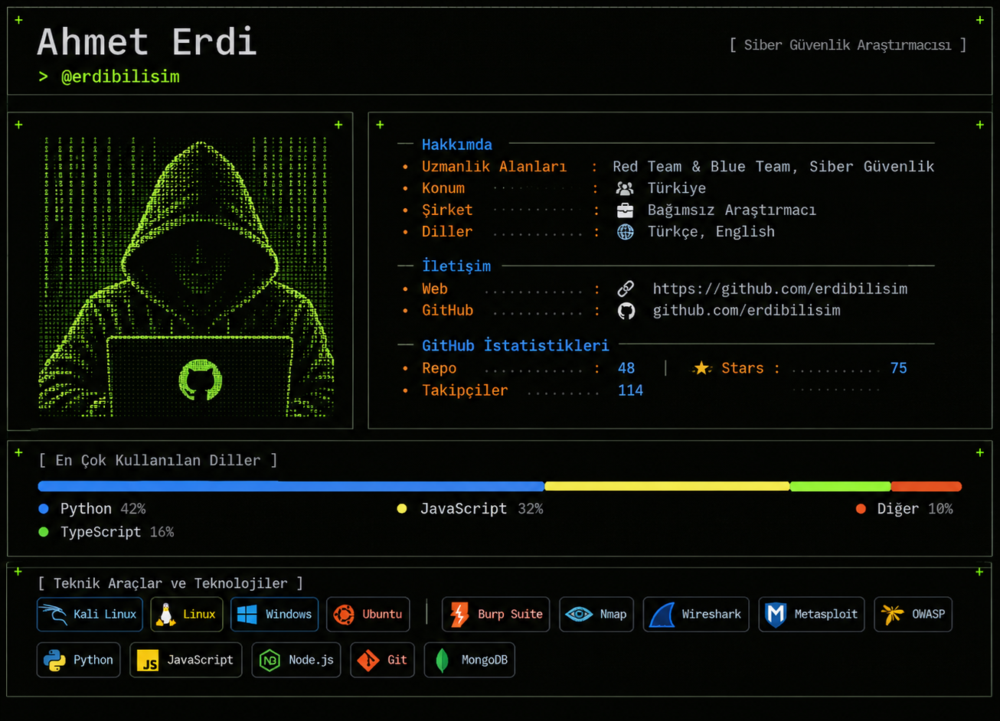

  

  <h1>Ahmet Erdi</h1>

  

    <b>Cybersecurity Researcher · Red Team · Blue Team</b> 
    Siber güvenlik araştırmaları, teknik incelemeler ve uygulamalı laboratuvar çalışmaları yürütüyorum.
    Bilgi ve deneyimlerimi Türkçe teknik içerikler, araştırma yazıları ve eğitim dokümanlarıyla paylaşmayı hedefliyorum.
  

  

    
    
    
    
  

  

    <a href="#">Research Areas</a> •
    <a href="#">Featured Research</a> •
    <a href="#">Research Workflow</a> •
    <a href="#">Technical Toolkit</a> •
    <a href="#">Initiatives</a> •
    <a href="#">GitHub</a> •
    <a href="#">Contact</a>
  

---

  
<b>[ CYBERSECURITY ] &nbsp; [ TECHNICAL RESEARCH ] &nbsp; [ PRACTICAL LEARNING ]</b>

  
<i>Siber güvenlik bilgisini Türkçe, erişilebilir ve uygulamaya dönük kaynaklarla geliştirmek.</i>

---

### 🔬 Research Areas

Siber güvenlik çalışmalarım; uygulama, ağ, altyapı ve donanım seviyesindeki güvenlik konularını kapsıyor.

  
  
  
  
  
  
  
  

- **Sızma Testleri:** Web uygulamaları, API, ağ ve altyapı güvenliği
- **Red Team:** Saldırı teknikleri, güvenlik testleri ve saldırı simülasyonları
- **Blue Team:** Savunma mekanizmaları, tehdit tespiti ve güvenlik analizi
- **Active Directory:** Etki alanı güvenliği ve saldırı yollarının analizi
- **Gömülü Sistemler:** Donanım arayüzleri ve cihaz güvenliği
- **IoT / ICS / OT:** Nesnelerin interneti ve endüstriyel sistem güvenliği
- **Tersine Mühendislik:** Yazılım ve donanım seviyesinde teknik incelemeler
- **Güvenlik Araştırmaları:** Zafiyet analizi, güvenlik kontrolleri ve teknik dokümantasyon

---

### 📰 Research Journal

Araştırma süreçlerini teknik inceleme, uygulamalı test ve dokümantasyon adımlarıyla ele alıyorum. Çalışmaların çıktısını tekrar incelenebilir ve öğrenilebilir teknik içeriklere dönüştürmeyi amaçlıyorum.

  

 

### ⚡ Featured Hardware Security Research

<table width="100%" border="0" cellpadding="0" cellspacing="0">
  <tr>
    <td width="40%" valign="middle" style="padding:0; line-height:0;">
      
    </td>
    <td width="60%" valign="middle" style="padding:12px;">
      <h3>Gömülü Sistemlerin Güvenlik Analizi</h3>
      
<strong>TP-Link WR840N v6.20</strong> Donanım Seviyesinde Güvenlik Araştırması

      
UART protokolü üzerinden gömülü sistemlerin donanım seviyesindeki güvenliğini inceleyen 12 bölümlük teknik araştırma serisi.

	  
<strong>ÜZERİNDE ÇALIŞILIYOR!</strong>

      

        
        
        
      

      
<a href="#"><strong>📂 ARAŞTIRMAYI İNCELE →</strong></a>

	   
    </td>
  </tr>
</table>

---

## How It Works

Araştırma ve eğitim çalışmalarımda izlediğim genel yaklaşım; konuyu tanımlamak, teknik olarak incelemek, kontrollü ortamda uygulamak ve elde edilen bulguları dokümante etmektir.

```mermaid
flowchart LR
    A["🎯 Konu / Problem"] --> B["🔬 Teknik Araştırma"]
    B --> C["🧪 Uygulamalı İnceleme"]
    C --> D["🖥️ Kontrollü Lab"]
    D --> E["📝 Teknik Dokümantasyon"]
    E --> F["📚 Eğitim İçeriği"]

    style A fill:#1f1f1f,stroke:#c5ff4a,stroke-width:1px,color:#ffffff
    style B fill:#060606,stroke:#252525,stroke-width:1px,color:#c5ff4a
    style C fill:#1f1f1f,stroke:#252525,stroke-width:1px,color:#ffffff
    style D fill:#060606,stroke:#252525,stroke-width:1px,color:#c5ff4a
    style E fill:#1f1f1f,stroke:#252525,stroke-width:1px,color:#ffffff
    style F fill:#060606,stroke:#c5ff4a,stroke-width:1px,color:#c5ff4a
```

### 1. Research & Analyze

Güvenlik konusunu ve araştırma problemini belirler; ilgili sistem, protokol veya uygulamanın çalışma mantığını incelerim.

### 2. Test in a Controlled Lab

Teorik bilgiyi uygulamalı testler ve kontrollü laboratuvar çalışmalarıyla desteklerim.

### 3. Document & Share

Araştırma sürecini, test metodolojisini ve bulguları anlaşılır, teknik ve tekrar uygulanabilir dokümanlara dönüştürürüm.

---

## Technical Toolkit

Çalışmalarımda kullandığım işletim sistemleri, güvenlik araçları ve geliştirme teknolojileri:

### Operating Systems & Environments

  
  
  
  

### Security & Analysis

  
  
  
  
  

### Development & Automation

  
  
  
  
  

---

## Initiatives

### Hacker Akademisi

Siber güvenlik alanında Türkçe eğitim içerikleri, modüler müfredatlar ve teknik dokümantasyon üretmeye odaklanan eğitim girişimi.

### HackerLab

Siber güvenlik eğitimlerini uygulamaya dönüştüren, sanallaştırılmış sistemler ve kontrollü laboratuvar ortamları üzerine kurulu uygulamalı eğitim girişimi.

---

## Research Principles

- Bilgiyi Türkçe ve teknik doğruluğu koruyarak paylaşmak.
- Teorik konuları uygulamalı laboratuvarlarla desteklemek.
- Araştırma süreçlerini anlaşılır ve tekrar uygulanabilir şekilde dokümante etmek.
- Siber güvenlik alanında açık kaynaklı ve erişilebilir bilgi üretimini desteklemek.

---

## Developer Scripts

Bu bölüm, GitAscii örneğindeki teknik envanter tablosunun kişisel profil çalışmalarına uyarlanmış halidir.

| Area | Focus |
| :--- | :--- |
| **Web & API Security** | Web uygulamaları, API güvenliği ve sızma testleri |
| **Network Security** | Ağ keşfi, trafik analizi ve altyapı güvenliği |
| **Red Team** | Saldırı teknikleri ve kontrollü güvenlik testleri |
| **Blue Team** | Savunma, tehdit tespiti ve güvenlik analizi |
| **Embedded Security** | UART ve gömülü cihaz arayüzleri |
| **Development** | Python, JavaScript, Node.js ve otomasyon |
| **Training** | Türkçe müfredat, laboratuvar ve teknik dokümantasyon |

---

## Contributing

Bilgi paylaşımını, teknik iş birliklerini ve siber güvenlik alanında Türkçe kaynak üretimini değerli buluyorum.

- Teknik araştırma ve dokümantasyon çalışmalarını desteklemek.
- Uygulamalı laboratuvar ve eğitim içeriklerine katkı sunmak.
- Açık kaynaklı ve erişilebilir bilgi üretimini teşvik etmek.
- Teknik konuları doğrulanabilir ve tekrar uygulanabilir şekilde ele almak.

  
<b>RESEARCH · BUILD · TEST · DOCUMENT · SHARE</b>

---

## 📈 GitHub Activity

  
  

---

## Contact

Siber güvenlik araştırmaları, teknik iş birlikleri ve Türkçe kaynak üretimi hakkında iletişim kurabilirsiniz.

  
  
<a href="#">github.com/erdibilisim</a>

  Bu profil, Türkçe siber güvenlik bilgi ve kaynaklarının geliştirilmesine katkı sağlamak amacıyla oluşturulmuştur.

