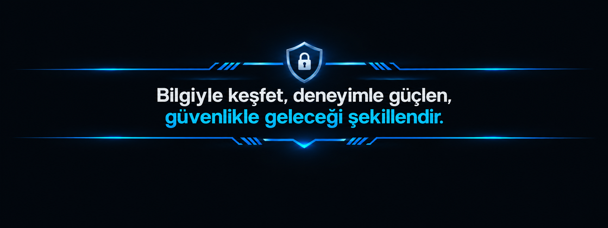

<div align="center">

  
  
  <br>

  <p>
    <h3>
		<a href="https://github.com/erdibilisim#featured-hardware-security-research">Siber Güvenlik Araştırmacısı</a>
		&nbsp;|&nbsp;
		<a href="#">Hacker Akademisi</a>
		&nbsp;&&nbsp;
		<a href="#">HackerLab</a>
		Markalarının Kurucusu
	</h3>
  </p>

  <p>
    Siber güvenlik alanında teknik araştırmalar, uygulamalı güvenlik testleri ve kontrollü laboratuvar çalışmaları gerçekleştiriyoruz. 
	Web ve API güvenliğinden ağ güvenliğine, donanım güvenliğinden gömülü sistem araştırmalarına kadar geniş bir yelpazede çalışmalar yürütüyoruz. 
	Bu çalışmalar kapsamında edindiğimiz bilgi ve deneyimleri teknik projelere, uygulamalı eğitimlere ve kapsamlı araştırma dokümanlarına dönüştürüyoruz. 
	Temel hedefimiz; siber güvenlik alanında nitelikli, erişilebilir ve özgün Türkçe teknik kaynaklar üreterek bilgi ve deneyimin paylaşımını teşvik etmek, 
	teknik yetkinliği geliştirmek ve daha güçlü bir siber güvenlik ekosisteminin oluşmasına katkı sağlamaktır.
  </p>

</div>

---
<div align="center">

   

  <p>
    <a href="#research-areas">Araştırma Alanlarımız</a>
    &nbsp;•&nbsp;
    <a href="#technical-toolkit">Teknik Araç Seti</a>
    &nbsp;•&nbsp;
    <a href="#featured-hardware-security-research">Featured Research</a>
    &nbsp;•&nbsp;
    <a href="#hacker-akademisi">Hacker Akademisi</a>
    &nbsp;•&nbsp;
    <a href="#hackerlab">HackerLab</a>
    &nbsp;•&nbsp;
    <a href="https://github.com/erdibilisim">GitHub</a>
    &nbsp;•&nbsp;
    <a href="#contact">Contact</a>
  </p>
</div>

---

<h2 id="research-areas">Araştırma Alanlarımız</h2>

Siber güvenlik çalışmalarımı aşağıdaki teknik alanlarda sürdürüyorum:

| Alan | Çalışma konuları |
|---|---|
| Web & API Security | Web uygulama güvenliği, API testleri, kimlik doğrulama ve yetkilendirme |
| Penetration Testing | Güvenlik test metodolojileri, zafiyet analizi ve kontrollü doğrulama |
| Network Security | Ağ keşfi, servis analizi, trafik inceleme ve ağ güvenliği |
| Embedded Systems & IoT | UART, donanım arayüzleri, firmware ve gömülü sistem güvenliği |
| Active Directory | Windows etki alanı güvenliği ve laboratuvar senaryoları |
| Linux Security | Linux sistem yönetimi, erişim kontrolleri ve güvenlik incelemeleri |
| Security Automation | Python, JavaScript ve otomasyon odaklı araç geliştirme |


<h2 id="technical-toolkit">Teknik Araç Seti</h2>

<div align="center">

  <!-- OPERATING SYSTEMS & INFRASTRUCTURE -->
  <h4>Operating Systems & Infrastructure</h4>

  <a href="https://www.kali.org/" target="_blank"></a>
  <a href="https://www.linux.org/" target="_blank"></a>
  <a href="https://www.microsoft.com/windows" target="_blank"></a>
  <a href="https://ubuntu.com/" target="_blank"></a>
  <a href="https://www.debian.org/" target="_blank"></a>
  <a href="https://www.proxmox.com/en/" target="_blank"></a>
  <a href="https://www.netgate.com/pfsense" target="_blank"></a>

  <br />

  <!-- SECURITY & PENETRATION TESTING -->
  <h4>Security & Penetration Testing</h4>

  <a href="https://portswigger.net/burp" target="_blank"></a>
  <a href="https://www.zaproxy.org/" target="_blank"></a>
  <a href="https://nmap.org/" target="_blank"></a>
  <a href="https://www.wireshark.org/" target="_blank"></a>
  <a href="https://www.metasploit.com/" target="_blank"></a>
  <a href="https://sqlmap.org/" target="_blank"></a>
  <a href="https://github.com/ffuf/ffuf" target="_blank"></a>

  <br />

  <!-- WEB & API SECURITY -->
  <h4>Web & API Security</h4>

  <a href="https://owasp.org/" target="_blank"></a>
  <a href="https://owasp.org/www-project-juice-shop/" target="_blank"></a>
  <a href="https://portswigger.net/web-security" target="_blank"></a>
  <a href="https://www.postman.com/" target="_blank"></a>

  <br />

  <!-- DEVELOPMENT & AUTOMATION -->
  <h4>Development & Automation</h4>

  <a href="https://www.python.org/" target="_blank"></a>
  <a href="https://developer.mozilla.org/en-US/docs/Web/JavaScript" target="_blank"></a>
  <a href="https://nodejs.org/" target="_blank"></a>
  <a href="https://www.gnu.org/software/bash/" target="_blank"></a>
  <a href="https://git-scm.com/" target="_blank"></a>
  <a href="https://www.docker.com/" target="_blank"></a>

  <br />

  <!-- DATABASE & WEB TECHNOLOGIES -->
  <h4>Database & Web Technologies</h4>

  <a href="https://www.mysql.com/" target="_blank"></a>
  <a href="https://expressjs.com/" target="_blank"></a>
  <a href="https://nginx.org/" target="_blank"></a>

  <br />

  <!-- HARDWARE & EMBEDDED SECURITY -->
  <h4>Hardware & Embedded Security</h4>

  <a href="https://www.arduino.cc/" target="_blank"></a>
  <a href="https://www.raspberrypi.com/" target="_blank"></a>
  <a href="https://ghidra-sre.org/" target="_blank"></a>

</div>


## Featured Hardware Security Research

<table width="100%" border="0" cellpadding="0" cellspacing="0">
  <tr>
    <td width="40%" valign="middle" style="padding:0; line-height:0;">
      <a href="#">
        
      </a>
    </td>
    <td width="60%" valign="middle" style="padding:12px;">
      <h3>
		<a href="#">
			Donanım Seviyesinde Yetkisiz Erişim: UART Protokolü İle Gömülü Sistemlerin İhlali
		</a>
	  </h3>
      <p><strong>Gömülü Sistemlerin Güvenlik Analizi</strong><br><strong>Hedef:<strong>&nbsp;<a href="#">TP-Link WR840N v6.20</a></p>
      <p>UART protokolü üzerinden gömülü sistemlerin donanım seviyesindeki güvenliğini inceleyen 12 bölümlük teknik araştırma serisi.</p>
      <p>
        
        
        
      </p>
    </td>
  </tr>
</table>


## Initiatives

### Hacker Akademisi

**Hacker Akademisi**, siber güvenlik konularını Türkçe, aşamalı ve uygulama odaklı eğitim içerikleriyle sunmayı amaçlayan eğitim platformudur.

- Linux ve siber güvenlik temelleri
- Web ve API güvenliği
- Red Team ve Blue Team konuları
- Ders dokümanları, laboratuvar görevleri ve değerlendirmeler

[Hacker Akademisi deposunu ziyaret et](#)

### HackerLab

**HackerLab**, siber güvenlik eğitimleri için kontrollü sanal laboratuvarlar, hedef sistemler ve uygulamalı test senaryoları geliştirmeye odaklanan çalışma alanımdır.

- İzole ve kontrollü laboratuvar altyapıları
- Güvenlik testlerine yönelik hedef sistemler
- Uygulamalı senaryolar ve teknik dokümantasyon

[HackerLab deposunu ziyaret et](#)

## Research Workflow

```text
   RESEARCH
      |
      v
   ANALYZE
      |
      v
   BUILD A CONTROLLED LAB
      |
      v
   TEST & VALIDATE
      |
      v
   DOCUMENT & SHARE
```

Çalışmalarımda kontrollü test ortamlarını, tekrarlanabilir yöntemleri ve teknik bulguların açık biçimde belgelenmesini esas alıyorum.

## Contact

Araştırmalar, teknik iş birlikleri ve eğitim içerikleri hakkında iletişim kurmak için GitHub profilimi ziyaret edebilirsiniz.

<div align="center">

  <a href="https://github.com/erdibilisim">
    
  </a>

  <p><sub>RESEARCH WITH CURIOSITY. TEST WITH DISCIPLINE. DOCUMENT WITH PRECISION.</sub></p>

</div>
